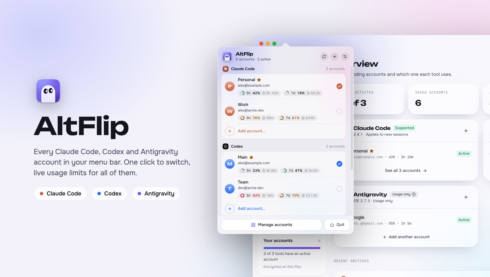
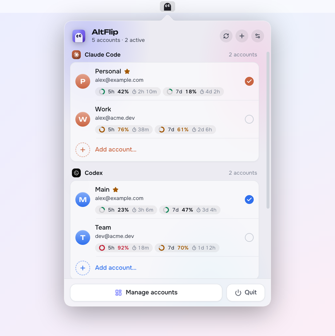
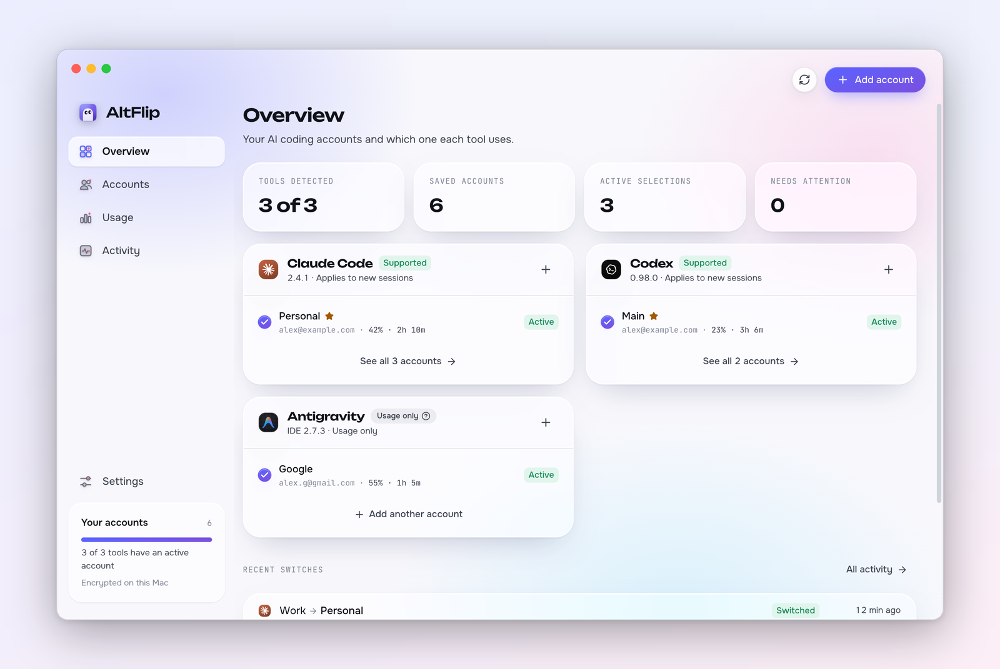
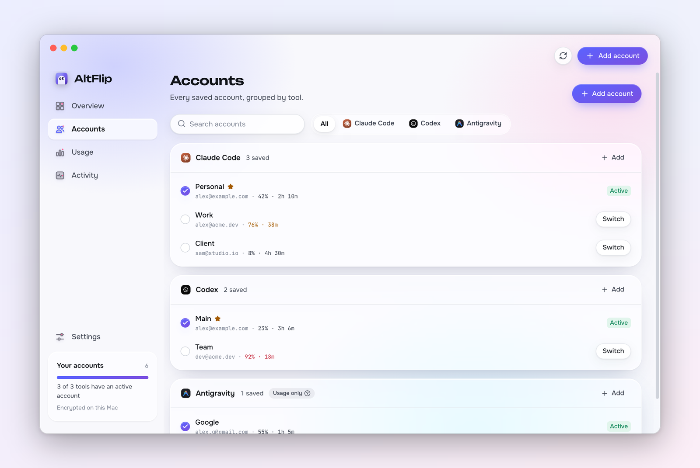
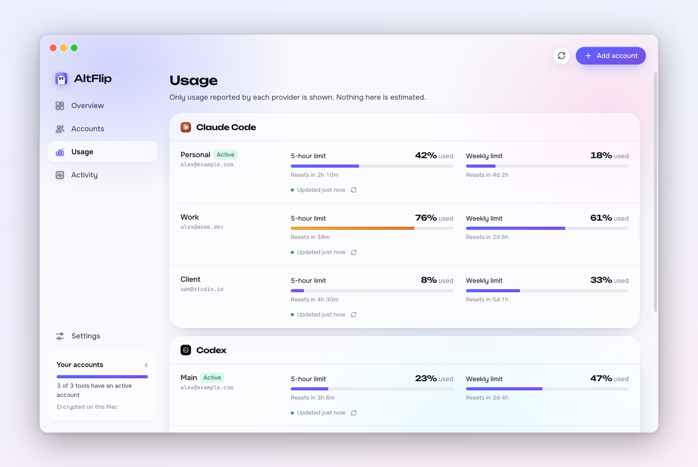
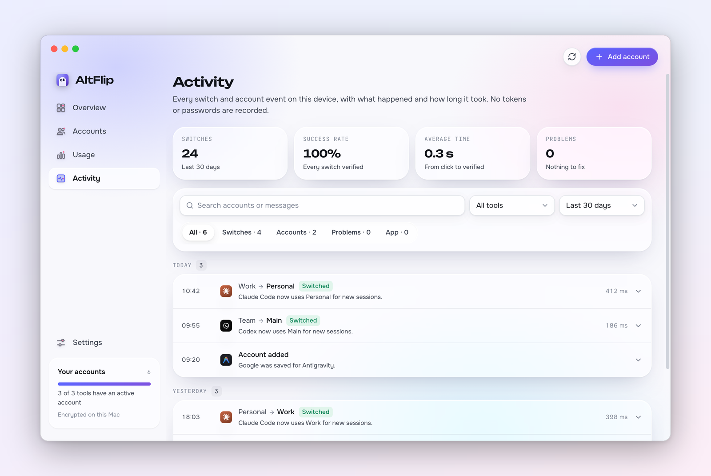

<picture>
  <source media="(prefers-color-scheme: dark)" srcset="assets/screenshots/banner-dark.png" />
  
</picture>

  

  
  
  
  

  <b>Switch Claude Code and Codex accounts in one click · See every usage limit live · Antigravity usage included</b>
   
  Free and open source. Everything stays on your computer.

---

## A look inside

  <picture><source media="(prefers-color-scheme: dark)" srcset="assets/screenshots/menu-dark.png" /></picture>
   
  The menu bar panel: every account, its limits and when they reset.

<table>
  <tr>
    <td width="50%"><picture><source media="(prefers-color-scheme: dark)" srcset="assets/screenshots/dashboard-dark.png" /></picture></td>
    <td width="50%"><picture><source media="(prefers-color-scheme: dark)" srcset="assets/screenshots/accounts-dark.png" /></picture></td>
  </tr>
  <tr>
    <td><b>Overview.</b> Every tool, the account it uses now, and recent switches.</td>
    <td><b>Accounts.</b> Every saved account, grouped by tool. Switch in one click.</td>
  </tr>
  <tr>
    <td width="50%"><picture><source media="(prefers-color-scheme: dark)" srcset="assets/screenshots/usage-dark.png" /></picture></td>
    <td width="50%"><picture><source media="(prefers-color-scheme: dark)" srcset="assets/screenshots/activity-dark.png" /></picture></td>
  </tr>
  <tr>
    <td><b>Usage.</b> 5-hour and weekly limits for every account, with reset times.</td>
    <td><b>Activity.</b> Every switch and account change, with how long it took and undo.</td>
  </tr>
</table>

Screenshots use made-up demo accounts.

## Features

- Save each account once through the tool's own sign-in. AltFlip never asks for passwords.
- Switch Claude Code and Codex in one click from the menu bar. One active account per tool.
- Every switch is verified; if anything fails, the previous sign-in is restored.
- Live 5-hour and weekly usage for every saved account, with reset countdowns and limit alerts.
- Antigravity: live per-model usage for every saved account (usage only, see the in-app **Usage only** button for why).
- Activity log of every switch and account event, with undo.
- Encrypted, passphrase-protected backups.
- Local only: no AltFlip account, no server, no telemetry.

## How it works

Architecture, switching, providers, security and release details live in [HOW-IT-WORKS.md](HOW-IT-WORKS.md).

## Install

Download the installer for your platform from [Releases](https://github.com/kiron0/altflip/releases/latest): `.dmg` for macOS, `.exe` or `.msi` for Windows, `.AppImage` or `.deb` for Linux.

## License

MIT © [Toufiq Hasan Kiron](https://github.com/kiron0)

The app and menu bar icons are based on the [AccountDeck](https://github.com/nadim-sheikh/AccountDeck) mascot, MIT © Nadim Sheikh ([license](assets/accountdeck/LICENSE)).
